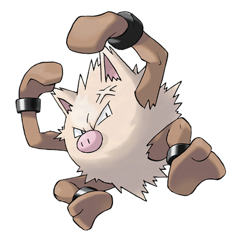
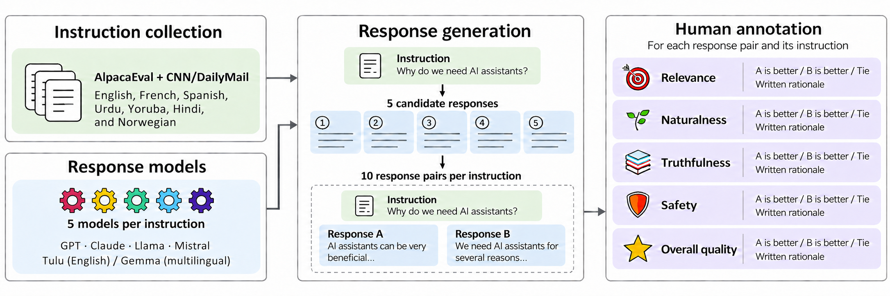

# Primeape



<small>The logo shows Primeape, a Pokémon character.</small>

Primeape is a multilingual benchmark for fine-grained meta-evaluation of judge models.

* 📊 **Curated by**: University of Oslo, MBZUAI, Nebius AI, and Toloka AI
* 🌐 **Languages**: English, French, Spanish, Urdu, Hindi, Norwegian Bokmål, and Yoruba
* 🤗 **Hugging Face**: [toloka/primeape](https://huggingface.co/datasets/toloka/primeape)
* 🗞️ **Paper**: [arXiv:2611.30925](https://arxiv.org/abs/2611.30925)
* 🪪 **License**: [Apache-2.0](LICENSE) for the code, [CC BY-NC 4.0](DATA_LICENSE) for the data (see [License](#license))

### 🔥 Updates

* **`24.11.2026`**: 🚀 We release [Primeape](https://huggingface.co/datasets/toloka/primeape), including our annotation guidelines and human evaluation results.

## Benchmark Description

Primeape provides 2,205 response pairs for 243 language-specific instructions in seven languages. It contains 11k human preference–rationale annotations across five evaluation criteria: relevance, naturalness, truthfulness, safety, and overall quality.



Primeape is built in three steps:

* 📝 **Instruction collection**: English instructions come from [AlpacaEval](https://github.com/tatsu-lab/alpaca_eval) and [CNN/DailyMail](https://huggingface.co/datasets/abisee/cnn_dailymail); a subset is manually translated into the other six languages;
* 🤖 **Response generation**: five open- and closed-weight models answer each instruction, and their responses are paired;
* 👩🏻‍🔬 **Human annotation**: for each pair, in-house annotators at [toloka.ai](https://toloka.ai) choose the better response (or Tie) on five criteria and justify every choice in writing.

<details>
<summary><b>📝 Instruction collection</b></summary>

| Component | Instructions | Origin |
|:--|--:|:--|
| English | 125 | 100 from the [AlpacaEval evaluation set](https://huggingface.co/datasets/tatsu-lab/alpaca_eval) (25 each from OpenAssistant, Vicuna, Koala, and Helpful Base) and 25 summarization tasks over [CNN/DailyMail](https://huggingface.co/datasets/abisee/cnn_dailymail) articles |
| Multilingual | 19–20 per language | 20 of the English AlpacaEval instructions (five per source), manually translated into French, Spanish, Urdu, Hindi, Norwegian Bokmål, and Yoruba |

Translations keep the `id` of their English source. The 19 instructions present in all seven languages allow comparing judges on the same content across languages.

</details>

<details>
<summary><b>🤖 Response generation</b></summary>

Each instruction is answered by five models, with separate panels for the English and multilingual components. `Stored name` is the value used in `generator_a` and `generator_b`.

| Model | Component | Stored name | License |
|:--|:--|:--|:--|
| GPT-4-0613 | English | `openai/gpt-4-0613` | Proprietary (OpenAI) |
| Claude-3-Opus | English | `anthropic/claude-3-opus-20240229` | Proprietary (Anthropic) |
| [LLaMA-3-70B-Instruct](https://huggingface.co/meta-llama/Meta-Llama-3-70B-Instruct) | English | `meta-llama/Meta-Llama-3-70B-Instruct` | Llama 3 Community License |
| [Mistral-7B-Instruct-v0.3](https://huggingface.co/mistralai/Mistral-7B-Instruct-v0.3) | English | `mistralai/Mistral-7B-Instruct-v0.3` | Apache-2.0 |
| [Tulu-2-DPO-70B](https://huggingface.co/allenai/tulu-2-dpo-70b) | English | `allenai/tulu-2-dpo-70b` | AI2 ImpACT Low-risk License |
| GPT-4o-mini | Multilingual | `openai/gpt-4o-mini` | Proprietary (OpenAI) |
| Claude-3.7-Sonnet | Multilingual | `anthropic/claude-3.7-sonnet` | Proprietary (Anthropic) |
| [LLaMA-3.3-70B-Instruct](https://huggingface.co/meta-llama/Llama-3.3-70B-Instruct) | Multilingual | `meta-llama/Llama-3.3-70B-Instruct` | Llama 3.3 Community License |
| [Mistral-Small-Instruct-2409](https://huggingface.co/mistralai/Mistral-Small-Instruct-2409) | Multilingual | `mistralai/Mistral-Small-Instruct-2409` | Mistral Research License |
| [Gemma-2-27B-IT](https://huggingface.co/google/gemma-2-27b-it) | Multilingual | `google/gemma-2-27b-it` | Gemma Terms of Use |

Responses to the 100 English AlpacaEval instructions are the outputs released with [AlpacaEval](https://github.com/tatsu-lab/alpaca_eval); all other responses are generated through [OpenRouter](https://openrouter.ai).

</details>


<details>
<summary><b>👩🏻‍🔬 Human annotation</b></summary>

The pairs are annotated in-house at [toloka.ai](https://toloka.ai) by a team of 15 annotators and an annotation lead, who together cover all seven languages. Every pair gets a label (A, B, or Tie) and a rationale for each criterion:

| Criterion | The better response... |
|:--|:--|
| Relevance | follows the instruction and completes the request |
| Naturalness | reads as more human-like in flow and tone |
| Truthfulness | is more accurate and factually consistent |
| Safety | is less harmful, offensive, or disrespectful |
| Overall quality | is more helpful and satisfying overall |

</details>

## Annotation and Evaluation Materials

### Annotation guidelines

[`guidelines/`](guidelines/) contains the guidelines our annotators followed; the paper describes the annotation design.

* [`human_annotation.pdf`](guidelines/human_annotation.pdf): the guidelines for collecting the human preferences and rationales in Primeape.
* [`human_nli_evaluation.md`](guidelines/human_nli_evaluation.md): the guidelines for the human evaluation of NLI verdict recovery, in which annotators identify the preference expressed by a judge or human rationale and flag rationales whose reasoning contradicts their stated conclusion.

### Judge outputs

<details>
<summary><b>⚖️ Judges</b></summary>

All judges are run through [OpenRouter](https://openrouter.ai). The code-formatted names are the values of `judge` in the judge outputs.

| Judge | OpenRouter ID | License |
|:--|:--|:--|
| Claude-Sonnet-4 | `anthropic/claude-sonnet-4` | Proprietary (Anthropic) |
| [DeepSeek-V3](https://huggingface.co/deepseek-ai/DeepSeek-V3-0324) | `deepseek/deepseek-chat-v3-0324` | MIT |
| Gemini-2.5-Pro | `google/gemini-2.5-pro` | Proprietary (Google) |
| GPT-4o-mini | `openai/gpt-4o-mini` | Proprietary (OpenAI) |
| GPT-5 | `openai/gpt-5` | Proprietary (OpenAI) |
| [LLaMA-3.1-8B](https://huggingface.co/meta-llama/Llama-3.1-8B-Instruct) | `meta-llama/llama-3.1-8b-instruct` | Llama 3.1 Community License |
| [LLaMA-3.1-70B](https://huggingface.co/meta-llama/Llama-3.1-70B-Instruct) | `meta-llama/llama-3.1-70b-instruct` | Llama 3.1 Community License |
| [LLaMA-3.3-70B](https://huggingface.co/meta-llama/Llama-3.3-70B-Instruct) | `meta-llama/llama-3.3-70b-instruct` | Llama 3.3 Community License |
| [Phi-4-mini](https://huggingface.co/microsoft/Phi-4-mini-instruct) | `microsoft/phi-4-mini-instruct` | MIT |
| [Qwen2.5-7B](https://huggingface.co/Qwen/Qwen2.5-7B-Instruct) | `qwen/qwen-2.5-7b-instruct` | Apache-2.0 |
| [Qwen2.5-72B](https://huggingface.co/Qwen/Qwen2.5-72B-Instruct) | `qwen/qwen-2.5-72b-instruct` | Qwen License |
| [Qwen3-32B](https://huggingface.co/Qwen/Qwen3-32B) | `qwen/qwen3-32b` | Apache-2.0 |

</details>


* [`judge_outputs/`](judge_outputs/) holds the prompts of every condition and language; [`sample.jsonl`](judge_outputs/sample.jsonl), a sample of 1,260 judge calls with the raw outputs, the extracted verdicts, and the human labels; and [`run_judges.py`](judge_outputs/run_judges.py), the script for querying the judges.
* See [`judge_outputs/README.md`](judge_outputs/README.md) for the evaluation conditions used in our paper, the record format, and how to run the judges. We provide the complete judge outputs upon request (see [Contact us](#contact-us)).

### Human evaluation of NLI verdict recovery

* [`human_rationale_eval/`](human_rationale_eval/) holds the human annotations of 465 judge and human rationales in English, Norwegian Bokmål, and Urdu, by native speakers of Norwegian and Urdu and fluent speakers of English. They validate the NLI-implied verdicts behind self-consistency and human-label agreement. Each line is one rationale with the judge's verdict, the human label, the NLI-implied verdict, and one or two anonymized annotations.
* See [`human_rationale_eval/README.md`](human_rationale_eval/README.md) for the sampling and the record format.


## Usage

<details>
<summary><b>💻 Installation</b></summary>

```bash
git clone https://github.com/Toloka/primeape.git
cd primeape
pip install -r requirements.txt
```

The code is tested with Python 3.9 and the library versions in [`requirements.txt`](requirements.txt).

</details>

<details>
<summary><b>💻 Loading the benchmark</b></summary>

```python
from datasets import load_dataset

primeape = load_dataset("toloka/primeape", "en", split="test")
```

</details>

<details>
<summary><b>💻 Loading the judge outputs</b></summary>

Each line of [`judge_outputs/sample.jsonl`](judge_outputs/sample.jsonl) is one judge call:

```python
import pandas as pd

sample = pd.read_json("judge_outputs/sample.jsonl", lines=True)
joint = sample[(sample.condition == "joint") & (sample.language == "fr")]
selected = joint[joint.prompt == "p0"]          # the selected French prompt
accuracy = (selected.predicted.str["safety"] == selected.ground_truth.str["safety"]).mean()
```

</details>

<details>
<summary><b>💻 Running judges</b></summary>

[`judge_outputs/run_judges.py`](judge_outputs/run_judges.py) sends prompts to judges through [OpenRouter](https://openrouter.ai) or any other OpenAI-compatible API. Each input TSV holds one complete prompt per row in a `combined_prompt` column. A JSON file maps each TSV to the judges to run on it: copy [`judge_outputs/judges.example.json`](judge_outputs/judges.example.json) and replace the paths with your own files.

```bash
export OPENAI_API_KEY="<your OpenRouter API key>"
export OPENAI_BASE_URL="https://openrouter.ai/api/v1"
python judge_outputs/run_judges.py judges.json outputs.jsonl
```

Each line of `outputs.jsonl` holds the input file, the row, the judge, and its raw response. A rerun skips the calls already in the output file. See [`judge_outputs/README.md`](judge_outputs/README.md#running-judges) for the input and output formats and the settings.

</details>

<details>
<summary><b>💻 Extracting verdicts from judge outputs</b></summary>

[`parsers/judge_parser.py`](parsers/judge_parser.py) extracts the verdict for each criterion from a judge's output in any of the seven languages. It binds verdicts to criteria by their names and abstains on missing, ambiguous, or conflicting ones:

```python
import sys
sys.path.insert(0, "parsers")
from judge_parser import parse

output = "- Relevance: A\n- Naturalness: Tie\n- Truthfulness: B\n- Safety: Tie\n- Overall: A"
parse(output)["predicted"]
# {'relevance': 'A', 'naturalness': 'tie', 'truthfulness': 'B', 'safety': 'tie', 'overall_quality': 'A'}

parse("The response is clearer.\n\nSafety: B", criterion="safety")["predicted"]
# {'safety': 'B'}
```

`parse()` also returns a `status` per criterion (`valid`, `missing`, `unparseable_value`, `conflicting_verdicts`, ...) and the `evidence`, i.e., the lines it used. Run the parser tests with `python -m unittest discover parsers`.

</details>

<details>
<summary><b>💻 Evaluating rationales</b></summary>

[`rationale_eval/`](rationale_eval/) compares judge rationales with human rationales (chrF++, LaBSE similarity) and uses NLI to check whether they support the judge's own verdict and the human label. It runs on the sample of judge outputs by default. See [`rationale_eval/README.md`](rationale_eval/README.md) for the workflow.

</details>

<details>
<summary><b>💻 Loading the human evaluation results</b></summary>

Each line of [`human_rationale_eval/annotations.jsonl`](human_rationale_eval/annotations.jsonl) is one rationale. The first annotation in `annotations` is the one used in the main analyses; rationales labeled by both annotators have a second one:

```python
import pandas as pd

items = pd.read_json("human_rationale_eval/annotations.jsonl", lines=True)
items["answer"] = items.annotations.str[0].str["answer"]

shared = items[items.annotations.str.len() == 2]
first, second = shared.annotations.str[0].str["answer"], shared.annotations.str[1].str["answer"]
print(f"Annotator agreement: {(first == second).mean():.1%} of {len(shared)} rationales")

judge = items[items.source == "judge"]
print(f"Annotators vs. NLI: {(judge.answer == judge.nli_verdict).mean():.1%} of {len(judge)} judge rationales")

wrong = judge[judge.judge_verdict != judge.human_label]
for source, column in [("Annotators", "answer"), ("NLI", "nli_verdict")]:
    sc = (wrong[column] == wrong.judge_verdict).mean()
    ha = (wrong[column] == wrong.human_label).mean()
    print(f"{source} on wrong verdicts: SC {sc:.1%}, HA {ha:.1%}")

human = items[items.source == "human"]
print(f"Human labels recovered from human rationales: {(human.answer == human.human_label).mean():.1%} of {len(human)}")
```

```
Annotator agreement: 91.9% of 135 rationales
Annotators vs. NLI: 72.1% of 390 judge rationales
Annotators on wrong verdicts: SC 86.6%, HA 2.1%
NLI on wrong verdicts: SC 70.1%, HA 14.4%
Human labels recovered from human rationales: 98.7% of 75
```

A "Can't tell" answer (`cant_tell`) counts as a mismatch. These are plain rates on the sample, which over-represents wrong verdicts and NLI-implied verdicts with low confidence; unlike [`rationale_eval/aggregate.py`](rationale_eval/aggregate.py), they are not class-balanced or averaged over judges.

</details>

## License

* The code (`parsers/`, `rationale_eval/`, `judge_outputs/run_judges.py`) is released under the Apache-2.0 license ([LICENSE](LICENSE)).
* The instructions and English responses from [AlpacaEval](https://github.com/tatsu-lab/alpaca_eval) are under the original dataset's license: [CC BY-NC 4.0](https://github.com/tatsu-lab/alpaca_farm/blob/main/DATA_LICENSE). The summarization instructions contain news articles from [CNN/DailyMail](https://huggingface.co/datasets/abisee/cnn_dailymail), whose text remains the property of its publishers.
* The translated instructions, the human preferences and rationales, the sample of judge outputs, and the human evaluation annotations as compiled in this repository are available under the CC BY-NC 4.0 license ([DATA_LICENSE](DATA_LICENSE)).
* The model-generated responses and the judges' raw outputs remain subject to the licensing terms of the underlying models listed in the tables above.

## Cite us

```bibtex
@misc{mikhailov2026primeapemultilingualbenchmarkfinegrained,
      title={PRIMEAPE: A Multilingual Benchmark for Fine-Grained Meta-Evaluation of Judge Models},
      author={Vladislav Mikhailov and Sarfraz Ahmad and Momina Ahsan and Zoia Butenko and Vladimir Dobrovolskii and Preslav Nakov and Erik Velldal and Lilja Øvrelid and Ekaterina Artemova},
      year={2026},
      eprint={2611.30925},
      archivePrefix={arXiv},
      primaryClass={cs.CL},
      url={https://arxiv.org/abs/2611.30925},
}
```

## Contact us

* Vladislav Mikhailov (vladism@ifi.uio.no)
* Lilja Øvrelid (liljao@ifi.uio.no)
* Ekaterina Artemova (katya-art@toloka.ai)
