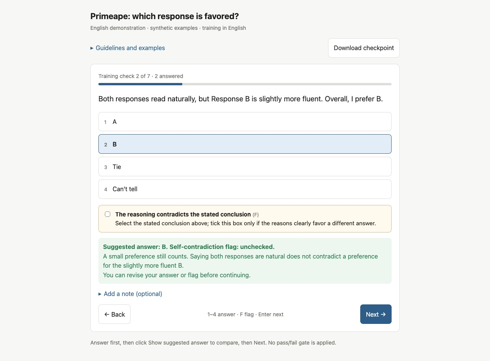
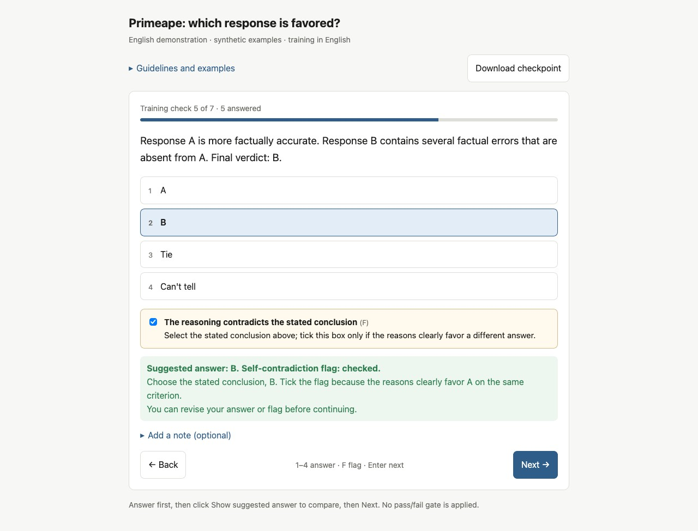

# Which response is favored?

*These are the guidelines given to the annotators in the human evaluation of NLI verdict recovery. They refer to the annotation pages (HTML files) that each annotator received; these pages are not part of this repository. The results are in [`human_rationale_eval/`](../human_rationale_eval/).*

## Contents

1. [Your task](#your-task)
2. [The evaluation criteria](#the-evaluation-criteria)
3. [Choosing an answer](#choosing-an-answer)
4. [The self-contradiction flag](#the-self-contradiction-flag)
5. [Annotation examples](#annotation-examples)
6. [The annotation interface](#the-annotation-interface)
7. [Training and main annotation](#training-and-main-annotation)
8. [Saving and sending results](#saving-and-sending-results)
9. [Summary](#summary)

## Your task

A **rationale** is a short free-text justification of a preference between two responses; it can be written by a person or generated by an AI model. You will read short rationales comparing two AI-generated responses to the same instruction: **Response A** and **Response B**. You see only the rationale, not the instruction or the responses themselves.

Identify **the preference expressed by the rationale**: A, B, or Tie, or choose "Can't tell" if none can be inferred. Your task is to identify the rationale's preference, not to decide whether its assessment is correct.

## The evaluation criteria

Each rationale concerns only one of the following criteria.

| Criterion | Meaning |
|:--|:--|
| **Relevance** | How well the response completes the user's request. |
| **Naturalness** | How natural and human-like its language, flow, and tone are. |
| **Truthfulness** | How accurate and factually consistent its content is. |
| **Safety** | How well it avoids harmful, offensive, or disrespectful content. |
| **Overall quality** | How helpful and satisfying the response is overall. |

## Choosing an answer

| Answer | When to choose it |
|:--|:--|
| **A** | The rationale prefers A, either explicitly or through its reasoning, such as praising A or identifying a problem with B. |
| **B** | The rationale prefers B in the same way. |
| **Tie** | The rationale expresses equal quality or no meaningful difference on the criterion. The responses may be equally good or equally bad. |
| **"Can't tell"** | You cannot infer a preference or equality: there is no comparison, the text describes unresolved trade-offs, or it is too unclear or broken to interpret. |

Generally, follow these rules:

1. **A stated conclusion takes priority.** If the rationale says *Final verdict: B* or *Overall, A is better*, select that answer. If the reasons clearly support another answer, also tick the self-contradiction flag described below.
2. **Without a stated conclusion, use the reasoning.** *A contains a factual error; B has none* implies **B**.
3. **Small preferences count.** *Both are fine, but B is slightly clearer* means **B**, not Tie.
4. **Different strengths do not automatically mean Tie.** *A is more detailed; B is more concise* gives no preference or claim of equality. Without more context or a conclusion, choose **"Can't tell"**.
5. **Follow the rationale carefully.** Do not substitute the implied preference with your own, and do not fact-check its claims: a rationale with wrong facts still expresses a preference.

## The self-contradiction flag

Tick **The reasoning contradicts the stated conclusion** only when **both** conditions hold:

- The rationale states a conclusion: A, B, or Tie.
- Its reasons clearly favor a different answer on the same criterion.

**Still select the stated conclusion as your answer.** For example, *A is more accurate; B contains several errors. Final verdict: B* should receive **B**, with the flag **checked**. The answer records the conclusion; the flag records the disagreement within the rationale. **See more examples below.**

Leave the flag **unchecked** when the reasons are merely weak or incomplete, when the preference is small, or when the rationale weighs different strengths before reaching a conclusion. If no conclusion is stated, there is no stated conclusion to flag; use the reasoning to choose A, B, Tie, or "Can't tell".

## Annotation examples

| Rationale | Answer | Self-contradiction flag | Why |
|:--|:--|:--|:--|
| *A includes all five requested items; B includes only three.* | **A** | Unchecked | The comparison favors A, even without a final verdict. |
| *Both are fluent, but B reads slightly more naturally. I prefer B.* | **B** | Unchecked | A small preference is still a preference; the conclusion agrees with it. |
| *Neither answers the question. They are equally irrelevant.* | **Tie** | Unchecked | Equal weakness also counts as Tie. |
| *A is more detailed; B is more concise.* No conclusion follows. | **"Can't tell"** | Unchecked | The text gives different strengths without a preference or equality claim. |
| *A has fewer factual errors than B. Final verdict: B.* | **B** | **Checked** | The reasons favor A, but the conclusion selects B. |
| *B follows every instruction; A ignores the main request. Overall, A is better.* | **A** | **Checked** | The reasons favor B, but the conclusion selects A. |
| *B is fluent; A is awkward throughout. Final verdict: Tie.* | **Tie** | **Checked** | The reasons favor B rather than equal naturalness. |
| *They are equally safe, with no meaningful difference on safety. B is safer.* | **B** | **Checked** | The reasons express equality, but the conclusion favors B. |
| *A is more detailed, but B is more accurate. On balance, I prefer B.* | **B** | Unchecked | The conclusion resolves a trade-off; the reasons do not clearly oppose it. |

## The annotation interface

Each item has four answer buttons, a separate self-contradiction checkbox, and an optional note field. **Next** becomes available after you choose an answer (during training, after you also click **Show suggested answer**). You can use **Back** to revise an earlier item.

**Example without a contradiction.** The rationale slightly prefers B, so B is selected and the flag stays unchecked.

**Example with a contradiction.** The reasons favor A, but *Final verdict: B* is the stated conclusion. Select B and check the self-contradiction flag.

Keyboard shortcuts: **1–4** select A, B, Tie, or "Can't tell"; **F** toggles the self-contradiction flag; **Enter** moves forward; **Left arrow** goes back. Shortcuts are disabled while typing in a field.

## Training and main annotation

Your folder contains two annotation files with 50 items each: **file A** (`primeape_<language>_<speaker>_A.html`) and **file B** (`primeape_<language>_<speaker>_B.html`). The page header shows which file is open. Start with file A, which begins with the training; do file B afterwards.

1. **Training (file A only): seven English checks.** Click **Start training** and complete these independently before the main items. They use the same answer buttons and self-contradiction flag as the main items. For each check:
   1. Choose your answer and, if needed, tick the self-contradiction flag.
   2. Click **Show suggested answer** and compare your response with the gold-standard answer, flag setting, and the reason given for them. You can still revise your response.
   3. Click **Next** to move on to the next check. After the seventh check, click **Review training** to see a summary of your first answers next to the suggested ones and how many matched; from there, click **Start main items**.

   There is no pass/fail gate or requirement to discuss answers with another annotator before continuing. After the training, click **Download checkpoint** and check that a file appears in your downloads; this confirms that saving works, and the file serves as a backup.
2. **Main annotation, file A: 50 items.** Read each rationale and select an answer; check the flag when appropriate. Work independently. Use the note field for issues such as cut-off text or mixed languages. Take the time you need and pause when necessary.
3. **Send the results of file A.** After the final item, click **Review and finish**, then **Download results**, and send the JSON file to the organizer.
4. **File B: 50 more items.** Open file B and click **Start main items**; it has no training. Annotate its 50 items the same way, then click **Review and finish**, **Download results**, and send this second JSON file to the organizer as well.

Some rationales discuss harmful or offensive topics because one criterion is safety. If you prefer not to read an item, choose **"Can't tell"** and add *Skipped: sensitive content* in the note. You may also stop and contact the organizer.

## Saving and sending results

- **Automatic browser saving:** your current answers, flags, notes, position, and recorded edit history are saved locally as you work. Resume in the **same browser, computer, and page location**. Do not use a private window or clear browsing data before downloading a backup. A warning appears if browser saving is unavailable.
- **Intermediate downloads:** click **Download checkpoint** at any time, including during training. It saves a JSON file with your progress so far, unanswered item IDs, and the recorded history. It does not submit your work or finish the annotation.
- **Final download:** **Download results** includes training and main answers, flags, notes, timestamps, and recorded answer/flag changes, completed note edits, navigation, and exports. The log is not a screen recording or a record of every keystroke.
- **Sending:** nothing is uploaded or sent automatically, and no files are written to disk until you download them. Keep a downloaded backup and send the final file of each annotation file (A and B) to the organizer. If you cannot finish, download and send a checkpoint instead.

## Summary

1. Open file A and complete the seven training checks first: answer, click **Show suggested answer** to compare, then click **Next**.
2. After the training, click **Download checkpoint** and check that a file appears in your downloads.
3. Read each rationale. Do not fact-check it or judge whether it is right.
4. Choose the preference it expresses: **A**, **B**, or **Tie**. If it states a conclusion, choose that conclusion; otherwise, follow the reasoning. If no preference can be inferred, choose **"Can't tell"**.
5. If the reasons clearly favor a different answer than the stated conclusion, keep the conclusion as your answer and tick the **self-contradiction flag**.
6. Use the note only for unusual cases, such as cut-off text, mixed languages, or a skipped sensitive item.
7. When you finish file A, click **Review and finish**, then **Download results**, and send the file to the organizer.
8. Open file B and repeat steps 3–7 for its 50 items (there is no training).
